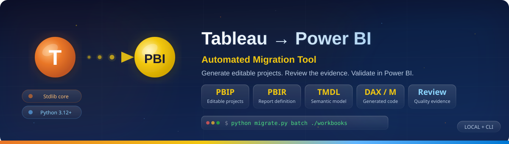
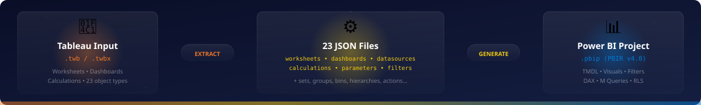
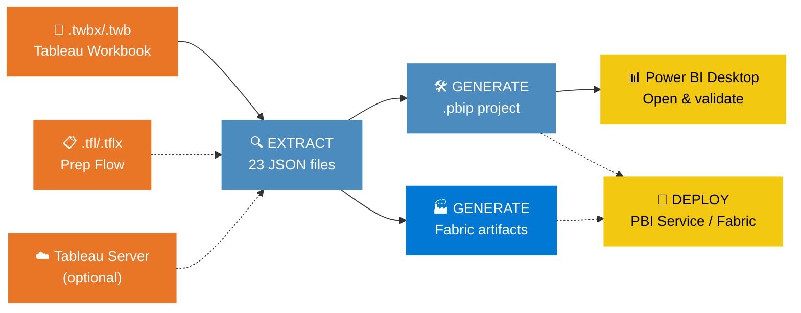
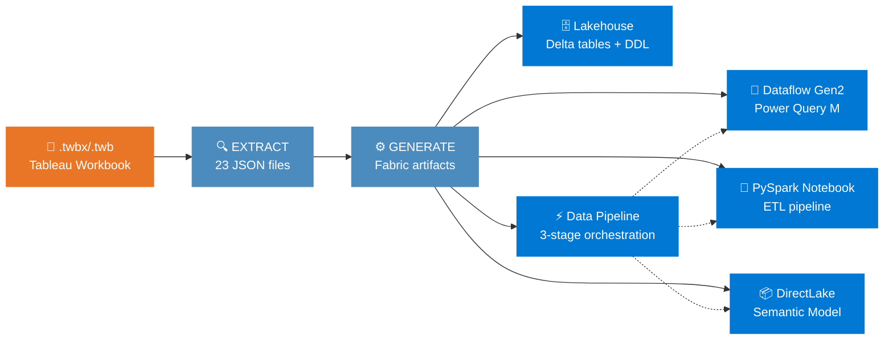
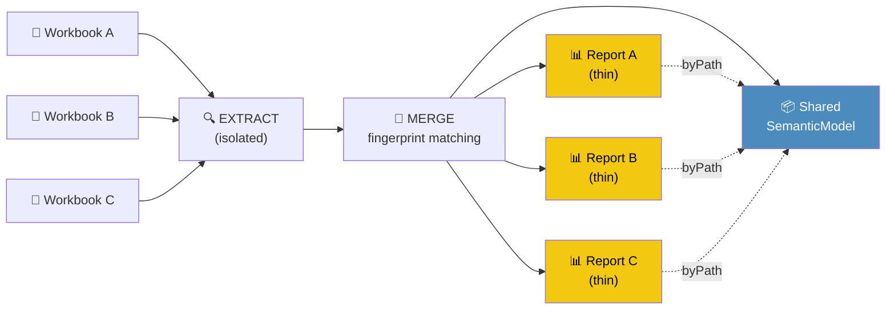
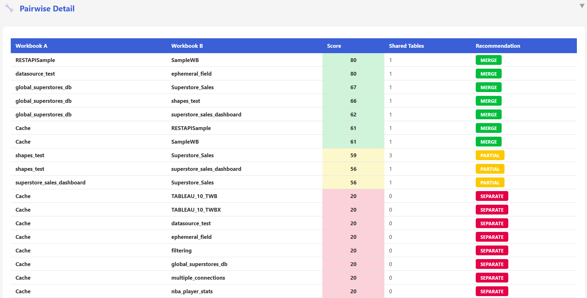
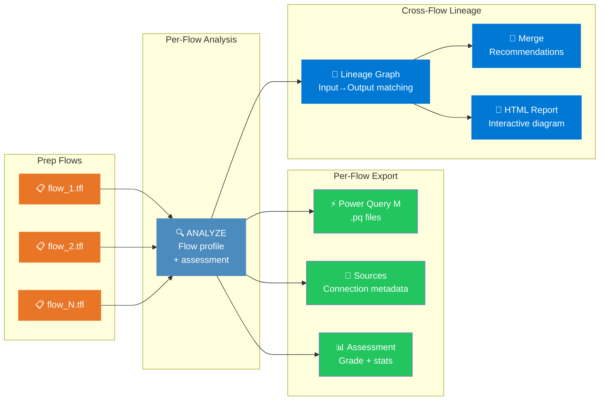
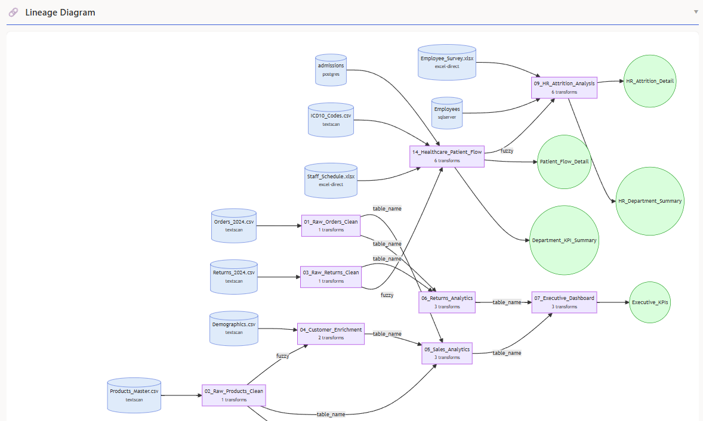
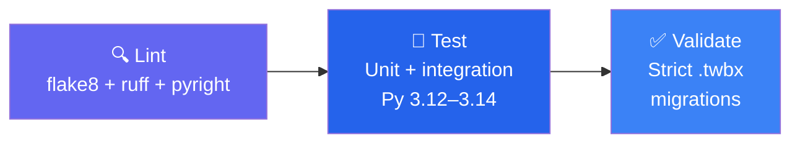
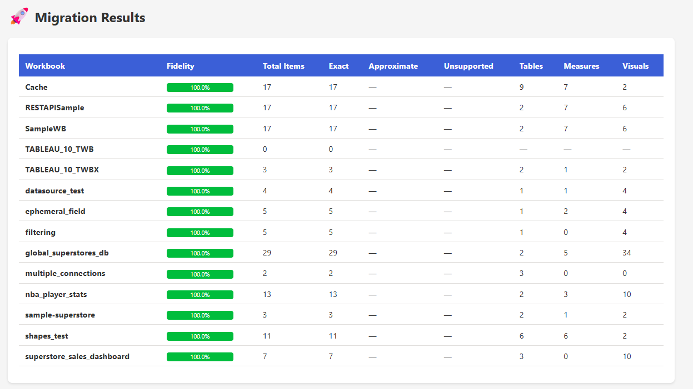

<p align="center">
  <a href="docs/README.md"></a>
</p>

# 🔄 Tableau → Power BI

**Automated Migration Tool** — automatically generate Power BI projects (`.pbip`) from Tableau workbooks (`.twb`/`.twbx`), with validation and manual review or adjustment where required.

<p align="center">
  <a href="pyproject.toml"></a>
  <a href="docs/POWERBI_PROJECT_GUIDE.md"></a>
  <a href="pyproject.toml"></a>
  <a href="https://github.com/cyphou/TableauToPowerBI/actions/workflows/ci.yml?query=branch%3Amain"></a>
</p>

<p align="center">
  <a href="#quick-start">⚡ Quick start</a> ·
  <a href="docs/README.md">📚 Documentation</a> ·
  <a href="docs/ARCHITECTURE.md#automatic-storage-mode-and-hyper-export">🗄️ Source strategy</a> ·
  <a href="docs/KNOWN_LIMITATIONS.md">⚠️ Limitations</a> ·
  <a href="CONTRIBUTING.md">🤝 Contribute</a>
</p>

| At a glance | Current contract |
|---|---|
| 🏷️ **Package metadata** | 44.0.0 in `pyproject.toml` · roadmap track v48 is separate |
| 🧪 **Verification** | The CI badge reflects the published `main` branch; see the [roadmap](docs/ROADMAP.md) for scoped local evidence |
| 🐍 **Python core** | 3.12+ · standard library only; Hyper SDK and deployment dependencies are optional |
| 📦 **Output** | Editable PBIP projects with PBIR reports, TMDL models and Power Query M; optional local Fabric scaffold |
| 📜 **License** | MIT |
| 🎯 **Inventory** | DAX conversion · 164 visual mapping records · 97 connector dispatch keys (55 generators) · 23 object types |

## 🧭 Choose your workflow

| Start here | Best for | Next step |
|---|---|---|
| 🌐 [Local browser](docs/LOCAL_WEB_UI.md) | Guided migration from local folder paths | Start `.\run_web_ui.ps1` |
| 💻 [CLI and operator guide](docs/USER_MANUAL.md) | Repeatable folder-based automation | Run `python migrate.py batch FOLDER --output-dir OUTPUT` |
| 🔎 [Review checklist](docs/MIGRATION_CHECKLIST.md) | Source setup, refresh, save/reopen and visual review | Inspect the generated evidence before publishing |
| 🏗️ [Architecture and source policy](docs/ARCHITECTURE.md#automatic-storage-mode-and-hyper-export) | Hyper exports, Import and DirectQuery choices | Review the decision diagram |

> [!IMPORTANT]
> Generation, static validation, successful refresh, visual/value parity and
> remote deployment are separate outcomes. No icon or badge certifies them all.

<details>
<summary><b>🧪 Dated verification evidence and current capabilities</b></summary>

### Verification evidence

Latest local publication-candidate checks (2026-10-23, Python 3.14.2):

- Full regression suite: **11,826 passed, 66 skipped, 1 xfailed**
  (**11,893 collected**), with one expected duplicate-ZIP-name fixture warning.
- This run includes the native Import/refresh-binding follow-ups and passive
  documentation-asset regressions. Skipped environment-dependent checks remain
  unexecuted; this is not Desktop refresh, rendered parity or deployment evidence.

Separate Microsoft authoring check (2026-10-23, CLI `0.5.0`):

- Regenerated the ten public/synthetic sample workbooks and checked their
  `.Report` directories with schema validation enabled: **4/10 passing and
  22 errors before the corrections; 10/10 passing, 0 errors and 0 warnings
  afterward**. See the [scoped roadmap evidence](docs/ROADMAP.md).
- Unified migration quality remains **4 PASS / 6 WARN / 0 FAIL**; its existing
  approximation and connector warnings are not overridden by the external check.
  This is PBIR evidence only, not TMDL/DAX engine, Desktop or refresh validation.
- The subsequent local regression run passed **11,850 tests**, with **66 skipped**,
  **1 xfailed** and **1 warning**. This is separate from the earlier
  publication-candidate baseline above and is not live CI status.

Earlier refresh-binding correction checks (2026-10-22):

- **863 targeted tests passed**: 771 affected-path tests plus 92 dedicated
  datasource-extractor tests. The native-path, full-width CSV, declared-field
  selection and partial-schema corrections are documented in the [changelog](CHANGELOG.md).
- These targeted checks are separate from the newer full-suite run above and
  do not certify native refresh, rendered parity or deployment for every workbook.

Earlier Hyper correction baseline (2026-10-22), before the native Import and
refresh-binding follow-ups:

- Full regression suite: **11,741 passed, 66 skipped, 1 xfailed**
  (**11,808 collected**).
- Real optional Hyper SDK checks: CSV and typed Parquet roundtrips, two schemas
  sharing a table name, row caps, newline progress, mixed automatic modes and
  forced Import. A valid **31,391,744-byte Hyper file with 30,000 rows** selected
  Parquet automatically; its real export was bound to an Import TMDL partition.
- These are local regression/export checks, not Power BI Desktop refresh,
  rendering or Fabric deployment evidence.

The following observations predate the Hyper correction slice; they are scoped
evidence, not a current full-suite or runtime certification:

- `python -m pytest tests/test_pbip_generator_coverage.py tests/test_openability.py -q` passed with `275 passed in 4.41s`.
- Targeted real-world migrations from `examples/real_world/` generated valid PBIP outputs and passed the local project-generation checks.
- The static openability and model/report validation gates continue to fail closed on malformed outputs rather than silently passing a broken project.
- Live Power BI Desktop and Fabric deployment remain explicit environment-gated checks; they are not inferred from static validation alone.
- Unified quality reports support `report`, `enterprise`, and `production` policies. Runtime semantic execution is `not_run` unless an authorized executor is supplied.

### Current capabilities

- **Static validation hardened around real-world blockers**: the generator now uses a stricter model/report contract and removes synthetic Tableau field references that were causing invalid visual-control bindings.
- **Optional Microsoft authoring check**: use the separately installed `powerbi-report-author` CLI to review generated PBIR roles, formatting and bookmark references. See the [local validation procedure](docs/POWERBI_PROJECT_GUIDE.md#optional-microsoft-pbir-validation); this is not model-engine or Desktop runtime evidence.
- **Quality evidence is explicit and deterministic**: static validation, warnings, and repair actions are recorded without overstating live Desktop/Fabric readiness.
- **MCP and CLI surfaces remain stable**: the concise 14-command CLI and quality/prioritization flows continue to document the verified static path cleanly.
- **Safety-first automation**: deployment remains dry-run by default, credentials stay in environment variables, and optional AI assistance only acts on verified findings.
- **Semantic runtime evidence**: an injected executor boundary records `not_run`, `passed`, or `failed` DAX evidence without requiring credentials in local CI. Use `--quality-policy report|enterprise|production` to control escalation of semantic diagnostics and unresolved lineage.
- **Visual mapping evidence**: the generator inventory is measured as 129 native mappings, 16 approximations, and 19 custom visual mappings; approximations remain explicit in quality evidence.
- **Evidence packages**: batch quality runs produce an `evidence_package_<workbook>.zip` containing quality status, lineage, M/visual matrices, Fabric evidence, manifests, priorities, and explicit runtime states.
- **Local browser UI**: start the Python migration interface from a source checkout with `.\run_web_ui.ps1`; see the [local browser guide](docs/LOCAL_WEB_UI.md).

These observations raise confidence in the stated local checks without
establishing live Desktop or Fabric deployment readiness.

</details>

<a id="quick-start"></a>

## ⚡ Quick Start

Start the guided interface from a repository checkout:

```powershell
.\run_web_ui.ps1
# Or start the same standard-library server directly:
python web\local_server.py
```

The browser opens at `http://127.0.0.1:8765/`. Enter separate absolute source
and output folder paths; no account, cloud hosting, upload, or frontend build
is needed. Keep the terminal open and stop it with Ctrl+C. Native diagnostics
require a separate confirmation. See the [local browser guide](docs/LOCAL_WEB_UI.md).

For terminal automation:

```powershell
# Generate PBIP projects from every workbook in a folder
python migrate.py batch .\workbooks --output-dir .\output
```

> [!TIP]
> The output is a `.pbip` project (PBIR v4.0). Every PBIP migration automatically
> runs a static openability gate over project structure, JSON, TMDL, Power Query M,
> DAX, report/model references, and PBIR schemas. Use `--no-verify-open` only to
> bypass this gate deliberately. Power BI Desktop is never launched automatically.
> For native checks, use the local browser's separately confirmed diagnostics or
> `python scripts\probe_projects.py PROJECTS_DIR`; batch does not forward the
> legacy `--desktop-probe` switch.

<details>
<summary><b>📦 Installation</b></summary>

```bash
git clone https://github.com/cyphou/TableauToPowerBI.git
cd TableauToPowerBI
python migrate.py batch ./workbooks --output-dir ./output
```

**Requirements:** Python 3.12+ • No `pip install` needed — pure standard library.

Optional dependencies:
```bash
pip install azure-identity requests   # Fabric/PBI Service deployment
pip install tableauhyperapi           # .hyper extract file reading (v2+ format)
```
</details>

### More ways to migrate

The public CLI has **14 commands**, including the legacy `deploy` alias
described below. These examples cover the other 13 workflows:

```powershell
# Migration generation is batch-only; a folder may contain one workbook.
python migrate.py assess workbook.twbx
python migrate.py migrate .\workbooks --output-dir .\output
python migrate.py batch .\workbooks --output-dir .\output
python migrate.py server https://tableau.example "Sales Dashboard"
python migrate.py merge wb1.twbx wb2.twbx --model-name "Sales"
python migrate.py fabric .\workbooks --output-dir .\fabric-output
# Deployment is a separate step using the MCP deploy tool (preview first).
python migrate.py qa .\workbooks
python migrate.py quality workbook.twbx
python migrate.py parity workbook.twbx
python migrate.py portfolio .\workbooks
python migrate.py plan https://tableau.example
python migrate.py lineage .\prep_flows
python migrate.py package .\workbooks
```

Generation commands (`migrate`, `batch`, and `fabric`) take a source folder;
put a single workbook in that folder when migrating only one. `assess` and
`parity` can inspect an individual workbook file. `quality` inspects an existing
migrated project for that workbook and requires its extraction data. `plan`
takes a Tableau Server/Cloud URL and requires valid server access.

`migrate FOLDER` and `batch FOLDER` both use bulk generation. The legacy
`deploy FOLDER WORKSPACE_ID` alias currently generates Fabric artifacts only:
the batch dispatcher does not forward deployment or pipeline-execution flags.
Use the separate deployment workflow described in the
[deployment guide](docs/DEPLOYMENT_GUIDE.md).

Use `python migrate.py quality workbook.twbx` after migrating that workbook to
inspect its combined assessment, feature parity, data coverage, interface
coverage, and Power BI openability. Use `parity` for feature coverage,
`portfolio` for folder assessment, `plan` for Tableau Server migration waves,
and `lineage` for Prep flows. `qa FOLDER` and `package FOLDER` follow the batch migration path: batch already
writes unified quality reports and evidence ZIPs, but does not run the specialized
six-check QA suite or the assessment report packager. The legacy `--qa` and
`--report-package` flags are not available through the supported batch-only
generation path. For a CI quality exit gate, run
`python migrate.py quality workbook.twbx --quality-strict` after generation;
batch does not forward `--quality-strict`, so its exit status alone is not a
quality PASS.
Use `--quality-policy report|enterprise|production` to control whether static
semantic diagnostics and unresolved lineage are informational, warnings, or
blocking findings. Runtime execution still requires an authorized executor.
Add `--quality-ai` for an optional summary based only on verified findings; AI
never changes the validation status.
Run `python migrate.py --help` for the concise command list. Supported
flag-based automation remains available through batch mode; direct single-file
project generation has been retired. Use `python migrate.py --advanced-help`
only when an advanced option is required. Secrets belong in environment
variables, never in command history.

### Client validation service (Windows)

**Bulk/batch only, not a single-file load:** select a source folder for
project generation, including when it contains just one workbook. Loading or
assessing a `.twb`/`.twbx` file alone does not generate a Power BI project.
Opening an already generated `.pbip` is a separate validation step.

Use this flow for a repeatable client migration plus a real Desktop opening
check. Keep customer source files and generated evidence outside this repository.
For explicit batch Tableau/PBI opening and side-by-side screenshots, see
[paired Desktop screenshots](docs/DEPLOYMENT_GUIDE.md#paired-tableau--power-bi-desktop-screenshots).
The paired capture script and its companion modules are included in the source
tree. Installed Desktop applications and an interactive Windows session are
still required; these diagnostics are not run automatically during migration.
This separate diagnostic captures initial window states by default. Add
`--all-pages` to inventory and attempt individual Tableau views and Power BI
pages, with verified UI selection and explicit failures for inaccessible views.
Tableau is not refreshed; the Power BI probe requests refresh and data
verification, which may access configured data sources over the network.
Add `--screen-comparison local` for deterministic PNG pixel differences without
an AI endpoint or network access in the comparison step. Manual review remains
the default. Full-window pixel metrics do not establish semantic parity, visual
fidelity, or loaded-data correctness.

```powershell
$py = ".\.venv\Scripts\python.exe"
$src = "C:\Client\Tableau"
$out = "C:\Client\Tableau\migration_output"
$env:POWERBI_DESKTOP_PATH = "C:\Program Files\Microsoft Power BI Desktop\bin\PBIDesktop.exe"

& $py migrate.py --batch $src --output-dir $out --verify-open --quiet
& $py scripts/probe_projects.py $out `
    --shots "$out\opening_validation\screenshots" `
    --json "$out\opening_validation\opening_report.json" `
    --html "$out\DESKTOP_OPENING_VALIDATION.html"
```

For each report the probe presses **Home > Refresh > Schema and data** through
UI Automation (English or French UI), checks refresh completion separately from
aggregate model rows, then captures the rendered page. A screenshot is labelled
*data verified* only after an observed successful refresh lifecycle and complete
table checks; rows alone are insufficient, and valid empty tables are not
refresh errors. `--no-refresh` skips the click and
`--skip-data-check` captures the window state only. `OPENED` means the
report window loaded, `CRASHED` means a Desktop crash or error dialog was
detected. `data_load.status=verified` means checked tables contained rows, not
that refresh succeeded; `refresh.status` records that separate result. Initial
calculated-object/no-data banners are normal for an unprocessed metadata-only
model. Configure sources, refresh, inspect the result, then save in Desktop to
retain its local cache. Keep the generated HTML/JSON report and screenshots beside the
external output directory; do not copy customer evidence into the repository.

### Local browser alternative (source checkout)

The standard-library runner provides a local-folder migration interface:

```powershell
powershell -ExecutionPolicy Bypass -File .\run_web_ui.ps1
# Or, with Python 3.12+ from the repository root:
python web\local_server.py
```

It binds only to `http://127.0.0.1:8765/` and opens the browser by default.
Use launcher `-NoBrowser` or Python `--no-browser` to suppress browser opening;
`-Port` / `--port` selects another port. Keep the terminal open and stop the
server with **Ctrl+C**; closing the browser tab does not stop it. This is a
local-only tool, not a production or multiuser web server.

The implemented backend takes separate local source/output folder paths (no
upload or cloud input), runs bulk migration even for one workbook, and exposes
PBIP/Fabric, culture, calendar years, quality policy and resume options.
Standalone Prep flows follow the engine's M/source-export route, not PBIP.
Generated artifact reports and an output ZIP are available through the backend.
Power BI **probe** and **Tableau/Power BI comparison** are separate,
explicitly confirmed actions: they can launch native apps, request Power BI
refresh/access configured networks, and save private screenshots. Migration
does not automatically run either diagnostic.

The local browser slice is delivered: the reported real-browser Superstore
migration succeeded with artifact/log display and a download link; both native
authorization dialogs were checked, and cancel submitted no job. Native
execution remains `not_run`; this is not N5 operational acceptance. This slice
does not include folder/ZIP upload or a Server workflow. See the
[local browser guide](docs/LOCAL_WEB_UI.md) and [operator workflow and boundaries](docs/USER_MANUAL.md#local-browser-alternative-source-checkout).
The existing `web/app.py` Streamlit workflow is separate; this runner does not
require Streamlit.

---

## 🎯 Key Features

<table>
<tr>
<td width="50%">

### 🔄 Complete Extraction
Parses **23 object types** from `.twb`/`.twbx`:
worksheets, dashboards, datasources, calculations, parameters, filters, stories,
actions, sets, groups, bins, hierarchies, sort orders, aliases, custom SQL,
user filters, Hyper metadata, datasource filters, custom geocoding, published
datasources, data blending, table extensions and linguistic schema. See the
[extraction contract](tableau_export/README.md).

**Hyper extract data:** export the complete packaged snapshot, then bind its
CSV or native Parquet files to Import partitions through exact physical
identities. Bounded streaming avoids full-table Python lists. Missing exports,
unknown or mismatched row counts, incomplete data and missing Import bindings
block the PBIP migration; producing a file alone is not a successful import.
Hyper uses Import; native database sources without Hyper use DirectQuery
when supported. The user can always force Import. For PBIP, native Hyper export
requires Parquet above 10 MiB and uses CSV otherwise. SQLite-compatible inputs
above that threshold fail unless CSV is explicitly selected. See the
[decision diagram](docs/ARCHITECTURE.md#automatic-storage-mode-and-hyper-export).
**Non-Hyper Import migrates the datasource, not its rows:** connection, schema
and Power Query M are generated without exporting native rows. One exception
to the native-file no-copy rule: an Excel workbook explicitly packaged in a
TWBX is copied unchanged into the project's `Data/` folder and bound by its
absolute path. Loose native files and packaged non-Excel files are not copied.
This exception covers trusted local per-workbook batch generation, not uploaded
jobs or shared-model/add-to-model/remove-from-model workflows.
Power BI loads native rows at refresh. Hyper data exports remain enabled.
The earlier no-copy follow-up passed **1,442 targeted tests**, before the
packaged-Excel exception; it does not establish native
Power BI refresh or replace the dated full-suite measurement above.
PBIP Hyper migrations reject row caps, including
`TTPBI_HYPER_EXPORT_MAX_ROWS`, rather than silently generating a partial model.
Metadata/header samples cannot replace a full reader. The original database
connection is not substituted for an available Hyper snapshot. See the
[large-extract options and progress](docs/FAQ.md#how-are-hyper-extract-files-handled).
Parquet uses a private ASCII transit path for native SDK writing, then Python
publishes the file at its actual destination, including accented paths.
Export completeness and static binding checks do not certify native refresh,
saved model data or visual parity.
Legacy `.tde` files must
be converted in Tableau or exported to CSV; `tableauhyperapi` does not read `.tde`.

</td>
<td width="50%">

### 🧮 DAX Formula Conversion
Translates Tableau formulas to DAX:
LOD expressions, table calcs, IF/ELSEIF, ISNULL, CONTAINS, window functions, iterators (SUMX), cross-table RELATED/LOOKUPVALUE, RLS security, regex patterns, SPLIT, statistical functions

</td>
</tr>
<tr>
<td>

### 📊 164 Visual Mapping Records
Includes 129 native mappings, 16 approximations, and 19 custom-visual mappings,
not a guarantee of exact rendering for every Tableau mark:
bar, line, pie, scatter, map, treemap, waterfall, funnel, gauge, KPI, box plot, word cloud, Sankey, Chord, combo charts, sparklines, and more

</td>
<td>

### 🔌 97 Connector Dispatch Keys
The dispatch table contains aliases for 55 distinct generator functions.
Generates Power Query M for:
SQL Server, PostgreSQL, BigQuery, Snowflake, Oracle, MySQL, Databricks, SAP HANA, Excel, CSV, SharePoint, Salesforce, Web, OData, Azure Blob, Vertica, Impala, Presto, Fabric Lakehouse, MongoDB, Cosmos DB, Athena, DB2, ServiceNow, Denodo, Essbase, Splunk, and more

</td>
</tr>
<tr>
<td>

### 🧠 Smart Semantic Model
Auto-generates Calendar table, date hierarchies, calculation groups, field parameters, RLS roles, display folders, geographic categories, number formats, perspectives, multi-language cultures

</td>
<td>

### 🚀 Separate Publishing Workflow
Deployment helpers support **Power BI Service** and **Microsoft Fabric** with
Azure AD authentication (Service Principal / Managed Identity) and gateway
configuration. Generation does not deploy; preview and authorize the separate
[deployment workflow](docs/DEPLOYMENT_GUIDE.md).

</td>
</tr>
<tr>
<td>

### 🏭 Fabric-Native Output
Generate **Lakehouse + Dataflow Gen2 + PySpark Notebook + DirectLake Semantic Model + Data Pipeline** with `--output-format fabric`. This is currently a validated scaffold; operational bindings and production deployment still require environment-specific configuration and verification.

</td>
<td>

### ⚡ DAX Optimizer
`--optimize-dax` rewrites verbose DAX: nested IF→SWITCH, IF(ISBLANK)→COALESCE, constant folding, SUMX simplification. `--time-intelligence auto` auto-injects YTD, PY, YoY% measures.

</td>
</tr>
<tr>
<td>

### 🔍 QA Suite & Auto-Fix
The legacy `--qa` post-generation QA option is not available through the
supported batch-only generation command. Batch migration writes the unified
quality report and evidence package by default; it does not run the specialized
six-check QA suite.

</td>
<td>

### 🔗 Lineage Map
Every migration produces a `lineage_map.json` tracking the provenance of every object: Tableau datasource.table → PBI table, Tableau calculation → PBI measure/column, relationships, and worksheet → page mappings. Visualized in the HTML dashboard with flow diagrams, stat cards, and searchable tabbed tables.

</td>
</tr>
<tr>
<td colspan="2">

### 🔗 Shared Semantic Model
Merge multiple Tableau workbooks into **one shared semantic model** with thin reports. Fingerprint-based table matching, Jaccard column overlap scoring, measure conflict resolution, merge assessment with 0–100 scoring, and automatic `byPath` report wiring. **Global assessment** (`--global-assess`) analyzes all workbooks pairwise to find merge clusters and generates an HTML report with a score heatmap matrix. **Fabric bundle deployment** (`--deploy-bundle`) deploys the shared model followed by thin reports; report failures are isolated, so partial deployment is possible.

</td>
</tr>
</table>

> [!NOTE]
> **Zero external dependencies** for core migration. The entire engine runs on Python's standard library.

---

## ⚙️ How It Works





**🔍 Step 1 — Extract:** Parses Tableau XML into 23 structured JSON files (worksheets, datasources, calculations, etc.)

**🛠️ Step 2 — Generate:** Converts JSON into a complete `.pbip` project with PBIR v4.0 report and TMDL semantic model

**🚀 Step 3 — Deploy** *(optional):* Packages and uploads to Power BI Service or Microsoft Fabric

### 🏭 Fabric-Native Output Mode

Use `--output-format fabric` to generate a **full Microsoft Fabric project** instead of a `.pbip`:



The pipeline generates **6 Fabric items** by default for each Tableau workbook in the source folder (five core items plus a report):

| Artifact | Description |
|----------|-------------|
| **Lakehouse** | Delta table schemas, Spark SQL DDL scripts, table metadata |
| **Dataflow Gen2** | Power Query M ingestion queries with Lakehouse destinations |
| **PySpark Notebook** | ETL pipeline (9 connector templates) + transformation notebook |
| **Semantic Model** | DirectLake TMDL pointing to Lakehouse Delta tables |
| **Power BI Report** | PBIR report connected to the semantic model |
| **Data Pipeline** | 3-stage orchestration: Dataflow → Notebook → Semantic Model refresh |

```bash
# Generate the complete six-item Fabric scaffold from a folder
python migrate.py fabric ./workbooks

# With custom output directory
python migrate.py fabric ./workbooks --output-dir /tmp/fabric_output
```

### 🔗 Shared Semantic Model Mode

When migrating multiple workbooks that share the same data sources, use `--shared-model` to produce **one shared semantic model** + **N thin reports**:



```bash
# Assess merge feasibility
python migrate.py merge wb1.twbx wb2.twbx wb3.twbx --assess-merge

# Generate shared model + thin reports
python migrate.py merge wb1.twbx wb2.twbx wb3.twbx --model-name "Shared Sales"

# Deploy shared model to Fabric workspace as a bundle
python migrate.py merge wb1.twbx wb2.twbx --deploy-bundle WORKSPACE_ID --bundle-refresh
```

The optional `--assess-merge` mode generates an interactive report with pairwise
merge scores, conflicts, and a merge recommendation. Portfolio-wide assessment and
deployment of an existing bundle are documented as advanced compatibility workflows
in [Enterprise Guide](docs/ENTERPRISE_GUIDE.md) and
[Deployment Guide](docs/DEPLOYMENT_GUIDE.md).

Reliability safeguards in shared-model mode:

- Shared semantic model fallback prevents an empty merged model when isolated-table filtering would otherwise remove every table.
- `--strict-merge` blocks generation on merge validation failures.
- `--strict-thin-report` blocks output when thin-report orphaned references exceed the allowed threshold.
- `--thin-report-max-orphans N` defines that threshold (default: `0`).


### 📋 Tableau Prep Flow Migration

Standalone `.tfl`/`.tflx` Prep flows are migrated **without generating a `.pbip` project** — instead, the tool produces **Power Query M expressions**, **source definitions**, **cross-flow lineage analysis**, and **merge recommendations**.



```bash
# Batch — analyze & export all .tfl files in a folder
python migrate.py batch examples/prep_portfolio/ --output-dir /tmp/prep_output

# Pair a prep flow with the workbook in a one-workbook source folder
python migrate.py batch ./workbooks --prep ./flows/flow.tflx --output-dir ./output
```

The lineage report shows cross-flow dependencies, merge candidates, and data provenance across your entire Prep portfolio:



<details>
<summary><b>📂 Prep flow batch output</b> (click to expand)</summary>

When running `--batch` on a folder of `.tfl` files, each flow produces:

```
prep_output/
├── 01_Raw_Orders_Clean/
│   ├── PowerQuery/
│   │   └── Orders_Clean.pq              ← Power Query M expression
│   ├── Sources/
│   │   └── Orders_2024.csv.json          ← Source connection metadata
│   └── assessment.json                   ← Grade, inputs, outputs, stats
├── 04_Customer_Enrichment/
│   ├── PowerQuery/
│   │   ├── Customer_360.pq
│   │   └── Demographics.pq
│   ├── Sources/
│   │   ├── CRM Customers.json
│   │   └── Demographics.csv.json
│   └── assessment.json
├── 14_Healthcare_Patient_Flow/
│   ├── PowerQuery/
│   │   ├── Department_KPI_Summary.pq
│   │   ├── Patient_Flow_Detail.pq
│   │   └── Physician_Performance.pq
│   ├── Sources/
│   │   ├── admissions.json
│   │   ├── ICD10_Codes.csv.json
│   │   ├── Procedures.json
│   │   └── Staff_Schedule.xlsx.json
│   └── assessment.json
└── prep_lineage/                         ← Cross-flow lineage (auto-generated)
    ├── prep_lineage_report.html          ← Interactive HTML with Mermaid diagram
    └── prep_lineage.json                 ← Machine-readable lineage graph
```

**Batch summary for prep flows:**

```
  Prep Flow                      Status    Grade   M Queries   Sources
  01_Raw_Orders_Clean                OK    GREEN           1         1
  04_Customer_Enrichment             OK    GREEN           2         2
  09_HR_Attrition_Analysis           OK    GREEN           4         3
  14_Healthcare_Patient_Flow         OK    GREEN           5         4
```

**Mixed directories** (`.twb` + `.tfl`) produce separate summary tables — workbooks get `.pbip` projects with fidelity scores, prep flows get Power Query M + sources + lineage.

</details>
### 📂 Generated Output

```
YourReport/
├── YourReport.pbip                     ← Project entry point (supported Desktop required)
├── migration_metadata.json             ← Stats, fidelity scores, warnings
├── lineage_map.json                    ← Source→target traceability
├── credentials_template.json           ← Datasource credential placeholders
├── YourReport.SemanticModel/
│   └── definition/
│       ├── model.tmdl                  ← Tables, measures, relationships
│       ├── expressions.tmdl            ← Power Query M queries
│       ├── roles.tmdl                  ← Row-Level Security
│       └── tables/
│           ├── Orders.tmdl             ← Columns + DAX measures
│           └── Calendar.tmdl           ← Auto-generated date table
└── YourReport.Report/
    └── definition/
        ├── report.json                 ← Report config + theme
        └── pages/
            └── ReportSection/
                ├── page.json           ← Layout + filters
                └── visuals/
                    └── [id]/visual.json ← Each visual
```

<details>
<summary><b>📂 Shared Semantic Model output</b> (click to expand)</summary>

When using `--shared-model`, the output is a single directory with one shared model and N thin reports:

```
SharedSales/
├── SharedSales.SemanticModel/            ← ONE shared semantic model
│   ├── .platform
│   ├── definition.pbism
│   └── definition/
│       ├── model.tmdl                    ← Merged tables, measures, relationships
│       ├── expressions.tmdl
│       ├── relationships.tmdl
│       └── tables/
│           ├── Orders.tmdl               ← Deduplicated across workbooks
│           ├── Customers.tmdl
│           └── Calendar.tmdl
├── WorkbookA.pbip                        ← Thin report A
├── WorkbookA.Report/
│   ├── definition.pbir                   ← byPath → ../SharedSales.SemanticModel
│   └── definition/
│       └── pages/
├── WorkbookB.pbip                        ← Thin report B
├── WorkbookB.Report/
│   ├── definition.pbir                   ← byPath → ../SharedSales.SemanticModel
│   └── definition/
│       └── pages/
└── merge_assessment.json                 ← Merge score, conflicts, recommendations
```

</details>

---

<a id="-dax-conversions-180-functions"></a>

## 🧮 DAX Conversions

> **Full reference:** [docs/TABLEAU_TO_DAX_REFERENCE.md](docs/TABLEAU_TO_DAX_REFERENCE.md)

<details>
<summary><b>📋 Complete conversion table</b> (click to expand)</summary>

| Category | Tableau | DAX |
|----------|---------|-----|
| Logic | `IF cond THEN val ELSE val2 END` | `IF(cond, val, val2)` |
| Logic | `IF ... ELSEIF ... END` | `IF(..., ..., IF(...))` |
| Null | `ISNULL([col])` | `ISBLANK([col])` |
| Null | `ZN([col])`, `IFNULL([col], 0)` | `IF(ISBLANK([col]), 0, [col])` |
| Text | `CONTAINS([col], "text")` | `CONTAINSSTRING([col], "text")` |
| Text | `ASCII`, `LEN`, `LEFT`, `RIGHT`, `MID` | `UNICODE`, `LEN`, `LEFT`, `RIGHT`, `MID` |
| Text | `UPPER`, `LOWER`, `REPLACE`, `TRIM` | `UPPER`, `LOWER`, `SUBSTITUTE`, `TRIM` |
| Agg | `COUNTD([col])` | `DISTINCTCOUNT([col])` |
| Agg | `AVG([col])` | `AVERAGE([col])` |
| Date | `DATETRUNC`, `DATEPART`, `DATEDIFF` | `STARTOF*`, `YEAR/MONTH/DAY/etc`, `DATEDIFF` |
| Date | `DATEADD`, `TODAY`, `NOW` | `DATEADD`, `TODAY`, `NOW` |
| Math | `ABS`, `CEILING`, `FLOOR`, `ROUND` | Identical or mapped |
| Stats | `MEDIAN`, `STDEV`, `STDEVP` | `MEDIAN`, `STDEV.S`, `STDEV.P` |
| Stats | `VAR`, `VARP`, `PERCENTILE`, `CORR` | `VAR.S`, `VAR.P`, `PERCENTILE.INC`, `CORREL` |
| Conversion | `INT`, `FLOAT`, `STR`, `DATE` | `INT`, `CONVERT`, `FORMAT`, `DATE` |
| Syntax | `==` | `=` |
| Syntax | `or` / `and` | `\|\|` / `&&` |
| Syntax | `+` (strings) | `&` |
| LOD | `{FIXED [dim] : AGG}` | `CALCULATE(AGG, ALLEXCEPT)` |
| LOD | `{INCLUDE [dim] : AGG}` | `CALCULATE(AGG)` |
| LOD | `{EXCLUDE [dim] : AGG}` | `CALCULATE(AGG, REMOVEFILTERS)` |
| Table Calc | `RUNNING_SUM / AVG / COUNT` | `CALCULATE(SUM/AVERAGE/COUNT)` |
| Table Calc | `RANK`, `RANK_UNIQUE`, `RANK_DENSE` | `RANKX(ALL())` |
| Table Calc | `WINDOW_SUM / AVG / MAX / MIN` | `CALCULATE()` |
| Iterator | `SUM(IF(...))` | `SUMX('table', IF(...))` |
| Iterator | `AVG(IF(...))` / `COUNT(IF(...))` | `AVERAGEX(...)` / `COUNTX(...)` |
| Cross-table | `[col]` other table (manyToOne) | `RELATED('Table'[col])` |
| Cross-table | `[col]` other table (manyToMany) | `LOOKUPVALUE(...)` |
| Security | `USERNAME()` | `USERPRINCIPALNAME()` |
| Security | `FULLNAME()` | `USERPRINCIPALNAME()` |
| Security | `ISMEMBEROF("group")` | `TRUE()` + RLS role per group |

</details>

### Highlights

```
┌─────────────────────────────────────────────────────────────────────────┐
│  Tableau LOD                    →  Power BI DAX                        │
├─────────────────────────────────────────────────────────────────────────┤
│  {FIXED [customer] : SUM([qty] * [price])}                             │
│  → CALCULATE(SUM('T'[qty] * 'T'[price]), ALLEXCEPT('T', 'T'[customer]))│
│                                                                         │
│  {EXCLUDE [channel] : SUM([revenue])}                                   │
│  → CALCULATE(SUM([revenue]), REMOVEFILTERS('T'[channel]))               │
│                                                                         │
│  SUM(IF [status] != "X" THEN [qty] * [price] ELSE 0 END)               │
│  → SUMX('Orders', IF('Orders'[status] != "X", [qty] * [price], 0))     │
│                                                                         │
│  RANK(SUM([revenue]))                                                   │
│  → RANKX(ALL(SUM('Table'[revenue])))                                    │
└─────────────────────────────────────────────────────────────────────────┘
```

---

<a id="-visual-type-mapping-128"></a>

## 📊 Visual Type Mapping

<details>
<summary><b>🎨 Full visual mapping table</b> (click to expand)</summary>

| Tableau Mark | Power BI visualType | Notes |
|-------------|-------------------|-------|
| Bar | `clusteredBarChart` | Standard bar |
| Stacked Bar | `stackedBarChart` | |
| Line | `lineChart` | With markers |
| Area | `areaChart` | |
| Pie | `pieChart` | |
| SemiCircle / Donut / Ring | `donutChart` | |
| Circle / Shape / Dot Plot | `scatterChart` | |
| Square / Hex / Treemap | `treemap` | |
| Text | `tableEx` | Table with text |
| Automatic | `table` | Default table |
| Map / Density | `map` | |
| Polygon / Multipolygon | `filledMap` | Choropleth |
| Gantt Bar | `clusteredBarChart` | Approximation; annotated `tableEx` fallback without a category |
| Histogram | `clusteredColumnChart` | |
| Box Plot | `boxAndWhisker` | |
| Waterfall | `waterfallChart` | |
| Funnel | `funnel` | |
| Bullet / Radial / Gauge | `gauge` | |
| Heat Map / Highlight Table | `matrix` | Conditional formatting |
| Explicit Packed Bubble / Strip Plot | `scatterChart` | Explicit marks may use scatter; review required roles |
| Shelfless inferred packed bubble | `treemap` | Empty Rows/Columns shelves, one Size measure + Colour dimension; approximation, not bubble geometry |
| Word Cloud | `wordCloud` | |
| Dual Axis / Combo / Pareto | `lineClusteredColumnComboChart` | |
| Sankey | `sankeyDiagram` | Custom visual GUID |
| Chord | `chordChart` | Custom visual GUID |
| Network | `networkNavigator` | Custom visual GUID |
| KPI | `card` | |
| Image | `image` | |
| 100% Stacked Area | `hundredPercentStackedAreaChart` | |
| Sunburst | `sunburst` | |
| Decomposition Tree | `decompositionTree` | |
| Shape Map | `shapeMap` | |

</details>

---

## 🏗️ Architecture

<details>
<summary><b>📁 Project structure</b> (click to expand)</summary>

```
TableauToPowerBI/
├── migrate.py                                 # CLI entry point (30+ flags)
├── tableau_export/                            # Tableau extraction
│   ├── extract_tableau_data.py                #   TWB/TWBX parser (23 object types)
│   ├── datasource_extractor.py                #   Connection/table/calc extractor
│   ├── dax_converter.py                       #   Tableau-to-DAX conversion and diagnostics
│   ├── m_query_builder.py                     #   97 dispatch keys / 55 connector generators
│   ├── prep_flow_parser.py                    #   Tableau Prep flow parser
│   ├── prep_flow_analyzer.py                  #   Prep flow profiler & assessment
│   ├── hyper_reader.py                        #   .hyper file data loader
│   ├── pulse_extractor.py                     #   Tableau Pulse metric extractor
│   └── server_client.py                       #   Tableau Server REST API client
├── powerbi_import/                            # Power BI generation
│   ├── import_to_powerbi.py                   #   Orchestrator
│   ├── pbip_generator.py                      #   .pbip project + visuals + filters
│   ├── visual_generator.py                    #   164 visual mapping records, PBIR configs
│   ├── tmdl_generator.py                      #   Semantic model → TMDL
│   ├── dax_optimizer.py                       #   DAX AST optimizer (v25)
│   ├── assessment.py                          #   Pre-migration assessment
│   ├── strategy_advisor.py                    #   Import/DQ/Composite advisor
│   ├── validator.py                           #   Artifact validation
│   ├── equivalence_tester.py                  #   Cross-platform validation (v25)
│   ├── regression_suite.py                    #   Regression snapshot testing (v25)
│   ├── html_template.py                       #   Shared HTML report template (CSS/JS)
│   ├── migration_report.py                    #   Per-item fidelity tracking
│   ├── goals_generator.py                     #   Tableau Pulse → PBI Goals
│   ├── shared_model.py                        #   Multi-workbook merge engine
│   ├── merge_assessment.py                    #   Merge assessment reporter
│   ├── thin_report_generator.py               #   Thin report (byPath) generator
│   ├── prep_lineage.py                        #   Cross-flow lineage graph engine
│   ├── prep_lineage_report.py                 #   Lineage HTML report & merge advisor
│   ├── plugins.py                             #   Plugin system
│   ├── fabric_project_generator.py            #   Fabric-native output (v25)
│   ├── api_server.py                          #   REST API server (v28)
│   ├── schema_drift.py                        #   Schema drift detection (v28)
│   └── deploy/                                #   Deploy to PBI Service / Fabric
├── Dockerfile                                 # Docker image for API server
├── tests/                                     # Unit, integration, and regression tests
├── web/                                       # Local browser UI and loopback runner
├── run_web_ui.ps1                             # Local browser launcher
├── docs/                                      # Guides and references; see docs/README.md
└── examples/                                  # Sample Tableau workbooks
```

</details>

---

## 📝 CLI Reference

This table includes advanced and legacy parser options, not a promise that every
option is forwarded by every generation route. Use `batch FOLDER` for workbook
generation and `merge WORKBOOK...` for shared models. The supported batch path
does not invoke the legacy single-file postprocessing suites or preceptor.
Batch dispatch forwards folder/output/Prep settings, extraction reuse,
calendar/culture, model mode, parallel/resume settings, JSONL/manifest,
full lineage, static openability, output format, quality policy and dry-run.
Automatic/forced storage mode, Hyper export format/row limits and ZIP limits are
also explicit batch controls.
Other rows below describe separate routes or retained parser options.

| Flag | Description |
|------|-------------|
| **Input & Output** | |
| `batch FOLDER` | Generate from a source folder; a workbook file alone is diagnostic input, not a generation command |
| `--prep FILE` | Tableau Prep flow (.tfl/.tflx) to merge with a workbook |
| `--output-dir DIR` | Batch output root; defaults to `<source-folder>\migrated` |
| `--output-format FORMAT` | Output format: `pbip` (default) or `fabric` |
| `--dry-run` | Preview migration without writing files |
| `--skip-extraction` | Skip extraction, re-use existing datasources.json |
| `--skip-conversion` | Legacy conversion toggle; not forwarded by batch generation |
| `--rollback` | Legacy backup toggle; not forwarded by batch generation |
| **Batch** | |
| `--batch DIR` | Batch-migrate all .twb/.twbx files in a directory |
| `--batch-config FILE` | JSON batch config with per-workbook overrides |
| `--workers N` | Parallel batch processing with N workers |
| **Hyper extracts** | |
| `--max-zip-entry-mb N` | Positive uncompressed entry limit in MiB; CLI overrides `TTPBI_MAX_ZIP_ENTRY_MB`, then 1024 MiB |
| `--hyper-export-format {auto,csv,parquet}` | PBIP `auto`: native Hyper > 10 MiB requires Parquet, otherwise CSV. Above-threshold SQLite-compatible inputs error unless CSV is explicit. Fabric `auto` stays CSV |
| `--hyper-export-max-rows N` | Positive diagnostic/Fabric staging cap; environment fallback `TTPBI_HYPER_EXPORT_MAX_ROWS`; a resolved cap is rejected for full PBIP Hyper generation |
| **Tableau Server / Cloud** | |
| `--server URL` | Tableau Server/Cloud URL |
| `--site SITE_ID` | Tableau site content URL |
| `--workbook NAME` | Workbook name or LUID to download |
| `--token-name NAME` | PAT name for Tableau Server auth |
| `TABLEAU_TOKEN_SECRET` | Environment variable for the PAT secret; do not put secrets in command arguments |
| `--server-batch PROJECT` | Download all workbooks from a server project (or `all`) |
| `--server-assets TYPE [...]` | Asset types: `workbooks`, `flows`, `datasources`, `all` |
| `--server-preserve-folders` | Mirror Tableau Server project folder structure locally |
| `--migrate-schedules` | Extract Tableau refresh schedules → PBI refresh config JSON |
| `--server-discover` | Discover site topology, dependency graph, and topology report |
| `--server-assess` | Server-level portfolio readiness report (GREEN/YELLOW/RED) |
| `--plan-migration` | Generate migration plan with wave assignments and effort estimates |
| `--team-size N` | Number of migration engineers for timeline calculation (default: 1) |
| **Shared Semantic Model** | |
| `--shared-model WB [WB ...]` | Merge multiple workbooks into one shared semantic model |
| `--model-name NAME` | Name for the shared semantic model (default: `SharedModel`) |
| `--assess-merge` | Only assess merge feasibility |
| `--force-merge` | Force merge even if score is below threshold |
| `--strict-merge` | Block generation on merge validation failures |
| `--strict-thin-report` | Block generation when thin-report orphaned references exceed the allowed threshold |
| `--thin-report-max-orphans N` | Maximum orphaned thin-report field references allowed when strict thin-report is enabled (default: `0`) |
| `--merge-preview` | Preview merge results without generating output |
| `--global-assess` | Cross-workbook pairwise merge scoring and clustering |
| **Deploy** | |
| `--deploy WORKSPACE_ID` | Legacy deployment flag; not dispatched by batch generation. Use separate deployment |
| `--deploy-refresh` | Legacy post-deployment refresh flag; not dispatched by batch generation |
| `--deploy-bundle WS_ID` | Deploy shared model followed by thin reports; partial deployment is possible |
| `--bundle-refresh` | Trigger dataset refresh after bundle deployment |
| `--sync` | Retired; does not detect Server changes or auto-deploy batch output |
| **Semantic Model** | |
| `--calendar-start YEAR` | Calendar table start year (default: 2020) |
| `--calendar-end YEAR` | Calendar table end year (default: 2030) |
| `--culture LOCALE` | Culture/locale for linguistic metadata (e.g., `fr-FR`) |
| `--languages LOCALES` | Shared-model culture files (e.g., `fr-FR,de-DE`); not forwarded by batch |
| `--mode MODE` | Default `auto`: Hyper/import-only sources use Import, capable native sources use DirectQuery; `import` overrides to Import. Native Import generates connection/schema/M without row export; explicitly packaged Excel is copied unchanged into `Data/` and bound by absolute path. Hyper still exports data. Advanced `directquery`/`composite` remain available |
| `--composite-threshold COLS` | Legacy per-table storage threshold; not forwarded by batch |
| `--agg-tables MODE` | Legacy aggregation-table toggle; not forwarded by batch |
| `--goals` | Legacy Pulse/Goals postprocessing toggle; not forwarded by batch |
| **Quality & Optimization** | |
| `--assess` | Run pre-migration assessment and strategy analysis |
| `--bulk-assess DIR` | Full portfolio assessment on a local folder (readiness + merge + prep lineage) |
| `--qa` | Legacy QA suite; unavailable through the supported batch-only workflow |
| `--preceptor` | Legacy parser option; not forwarded by batch/shared-model generation. A separately invoked review scores six dimensions without calling agents or applying fixes |
| `--no-preceptor` | Legacy parser option; batch/shared-model generation does not invoke the review |
| `--preceptor-block` | Legacy parser option; does not establish a gate in batch/shared-model generation |
| `--optimize-dax` | Legacy optimizer toggle; not forwarded by batch |
| `--no-optimize-dax` | Legacy optimizer toggle; does not disable batch processing |
| `--time-intelligence MODE` | Legacy Time Intelligence toggle; not forwarded by batch |
| `--validate-data` | Legacy value-validation toggle; not forwarded by batch |
| `--compare` | Legacy comparison-report toggle; not forwarded by batch |
| `--no-compare` | Legacy comparison toggle; does not disable batch quality reports |
| `--check-drift DIR` | Legacy postprocessing flag, not forwarded by batch; use the [schema-drift Python API](docs/FAQ.md#how-do-i-detect-schema-drift-between-migrations) |
| `--autoplay` | Legacy QA toggle; not forwarded by batch |
| **Prep Flows** | |
| `--prep-lineage PATHS` | Cross-flow lineage analysis for .tfl/.tflx files |
| **Other** | |
| `--verbose` / `-v` | Enable verbose (DEBUG) console logging |
| `--quiet` / `-q` | Suppress all output except errors |
| `--log-file FILE` | Write logs to a file |
| `--wizard` | Launch interactive migration wizard |
| `--paginated` | Legacy paginated-report toggle; not forwarded by batch |
| `--config FILE` | Load settings from a JSON configuration file |
| `--telemetry` | Enable anonymous usage telemetry (opt-in) |
| `--dashboard` | Generate telemetry dashboard |
| `--incremental DIR` | Merge changes into existing .pbip |

---

## 🚀 Deployment

<details>
<summary><b>Fabric end-to-end deployment</b></summary>

```bash
# Set FABRIC_TENANT_ID, FABRIC_CLIENT_ID, and FABRIC_CLIENT_SECRET first.
python migrate.py fabric ./workbooks --output-dir ./fabric-output
```

The command generates Lakehouse, Dataflow Gen2, Notebook, Direct Lake
Semantic Model, Power BI report, and Pipeline artifacts locally. Batch dispatch
does not forward deployment or refresh flags. Deployment is a separate,
explicitly authorized step; see the [Deployment Guide](docs/DEPLOYMENT_GUIDE.md)
for identity setup and supported deployment entry points.

Or programmatically:

```python
from powerbi_import.deploy.pbi_deployer import PBIWorkspaceDeployer

deployer = PBIWorkspaceDeployer(workspace_id="your-workspace-guid")
result = deployer.deploy("artifacts/powerbi_projects/MyReport", refresh=True)
```

</details>

<details>
<summary><b>Microsoft Fabric</b></summary>

```bash
export FABRIC_WORKSPACE_ID="your-workspace-guid"
export FABRIC_TENANT_ID="your-tenant-guid"
export FABRIC_CLIENT_ID="your-app-client-id"
export FABRIC_CLIENT_SECRET="your-app-secret"

python -c "
from powerbi_import.deploy.deployer import FabricDeployer
deployer = FabricDeployer(workspace_id='your-workspace-guid')
deployer.deploy_artifacts_batch('artifacts/powerbi_projects/')
"
```

</details>

<details>
<summary><b>Environment configurations</b></summary>

| Environment | Log Level | Retry | Validate | Approval |
|-------------|-----------|-------|----------|----------|
| development | DEBUG | 3 | No | No |
| staging | INFO | 3 | Yes | No |
| production | WARNING | 5 | Yes | Yes |

</details>

---

## ✅ Validation

```python
from powerbi_import.validator import ArtifactValidator

result = ArtifactValidator.validate_project("artifacts/powerbi_projects/MyReport")
# {"valid": True, "files_checked": 15, "errors": []}
```

The validator checks `.pbip` JSON, `report.json`, `model.tmdl`, page/visual structure, and `sortByColumn` cross-references.

---

## 🧪 Testing

```bash
python -m pytest tests/ -v                          # Run all tests
python -m pytest tests/test_dax_converter.py -v      # Run specific file
python -m pytest tests/ --cov --cov-report=html      # Coverage report
RUN_OPENABILITY_SUITE=1 python -m pytest tests/test_desktop_openability_suite.py -v  # Fixture-based Desktop openability suite
python -m pytest tests/test_openability.py -v         # Static PBIP openability checks
```

<details>
<summary><b>📋 Test suite breakdown</b> (click to expand)</summary>

| Test File | Coverage |
|-----------|----------|
| `test_dax_coverage.py` | Edge cases across DAX categories |
| `test_generation_coverage.py` | TMDL/PBIR generation edge cases |
| `test_m_query_builder.py` | Power Query M connectors and transforms |
| `test_tmdl_generator.py` | Semantic model, Calendar, TMDL |
| `test_dax_converter.py` | DAX formulas, LOD, table calcs |
| `test_error_paths.py` | Error handling and explicit failure paths |
| `test_extract_coverage.py` | Stories, actions, sets, bins, hierarchies |
| `test_visual_generator.py` | Visual mappings, sync, buttons |
| `test_non_regression.py` | End-to-end sample workbook migrations |
| `test_prep_flow_parser.py` | Prep parsing, DAG, step conversion |
| `test_assessment.py` | Readiness scoring and diagnostics |
| `test_cli_wiring.py`, `test_local_web_ui.py` | CLI dispatch and local browser backend |
| Other test files | See the [test guide](tests/README.md) and CI for current counts/results |

</details>

### CI/CD Pipeline



Staging and production deployment jobs are currently disabled in the
[CI workflow](.github/workflows/ci.yml). A successful CI run is not a Fabric
deployment or native Desktop refresh result. GitHub Pages documentation
publishing uses a [separate workflow](.github/workflows/gh-pages.yml).

### 📊 Migration Report

After batch migration, run `python generate_report.py` to produce an HTML Migration & Assessment Report with per-workbook fidelity scores:



The report shows for each migrated workbook:
- **Fidelity** — percentage of items migrated successfully (100% = everything converted)
- **Total Items / Exact / Approximate / Unsupported** — breakdown of migration quality per item
- **Tables / Measures / Visuals** — counts of generated artifacts in the output .pbip project

---

## 📚 Documentation

The [documentation hub](docs/README.md) groups guides by operator, conversion
and developer tasks. Start with the browser guide or the operator manual, then
use the review checklist before any publishing step.

| Document | Description |
|----------|-------------|
| 📘 [User Manual](docs/USER_MANUAL.md) | Operator guide and Tableau → Power BI correspondence table |
| 📖 [Migration Checklist](docs/MIGRATION_CHECKLIST.md) | Step-by-step migration guide |
| 🗺️ [Mapping Reference](docs/MAPPING_REFERENCE.md) | Tableau → Power BI mappings |
| 🌐 [Local Browser UI](docs/LOCAL_WEB_UI.md) | Local launch, folders, diagnostics and troubleshooting |
| 📚 [Documentation Index](docs/README.md) | All maintained guides and developer references |
| 🔢 [DAX Function Reference](docs/TABLEAU_TO_DAX_REFERENCE.md) | Conversion patterns, approximations and manual cases |
| ⚡ [Power Query M Reference](docs/TABLEAU_TO_POWERQUERY_REFERENCE.md) | Source properties, connectors and transformations |
| 🔄 [Prep → M Reference](docs/TABLEAU_PREP_TO_POWERQUERY_REFERENCE.md) | Prep transformations and supported parser contract |
| 📋 Prep Flow Lineage | Cross-flow lineage, Power Query M export, merge recommendations (`--batch` / `--prep-lineage`) |
| 🏗️ [Architecture](docs/ARCHITECTURE.md) | System design overview |
| 📊 [.pbip Guide](docs/POWERBI_PROJECT_GUIDE.md) | Output format explained |
| 🚀 [Deployment Guide](docs/DEPLOYMENT_GUIDE.md) | PBI Service & Fabric deploy |
| ⚠️ [Known Limitations](docs/KNOWN_LIMITATIONS.md) | Current limitations |
| 🔧 [Tableau Versions](docs/TABLEAU_VERSION_COMPATIBILITY.md) | Version compatibility |
| ❓ [FAQ](docs/FAQ.md) | Frequently asked questions |
| 🤝 [Contributing](CONTRIBUTING.md) | How to contribute |
| 📝 [Changelog](CHANGELOG.md) | Change notes |
| 🏢 [Enterprise Guide](docs/ENTERPRISE_GUIDE.md) | 8-phase enterprise migration guide |
| 📈 [Roadmap](docs/ROADMAP.md) | Development roadmap |
| 🤖 [Agents](docs/AGENTS.md) | 17-agent specialization model |
| 🌐 Global Assessment | Cross-workbook merge analysis with HTML heatmap (`--global-assess`) |
| 🚀 Bundle Deployment | Deploy shared model + reports to Fabric (`--deploy-bundle`) |

---

## ⚠️ Known Limitations

- `MAKEPOINT()` (spatial) has no DAX equivalent — skipped
- `PREVIOUS_VALUE()` / `LOOKUP()` use OFFSET-based DAX — may need manual tuning
- Data source connection strings must be reconfigured in Power Query after migration
- Some table calculations (`INDEX()`, `SIZE()`) are approximated
- See [docs/KNOWN_LIMITATIONS.md](docs/KNOWN_LIMITATIONS.md) for the full list

---

## 🤝 Contributing

Contributions are welcome! See [CONTRIBUTING.md](CONTRIBUTING.md) for guidelines.

```bash
git clone https://github.com/cyphou/TableauToPowerBI.git
cd TableauToPowerBI
python -m pytest tests/ -q  # Make sure tests pass
```

---

## 📜 License

MIT

[⬆️ Back to quick start](#quick-start) · [📚 Documentation hub](docs/README.md) · [🤝 Contributing](CONTRIBUTING.md)
